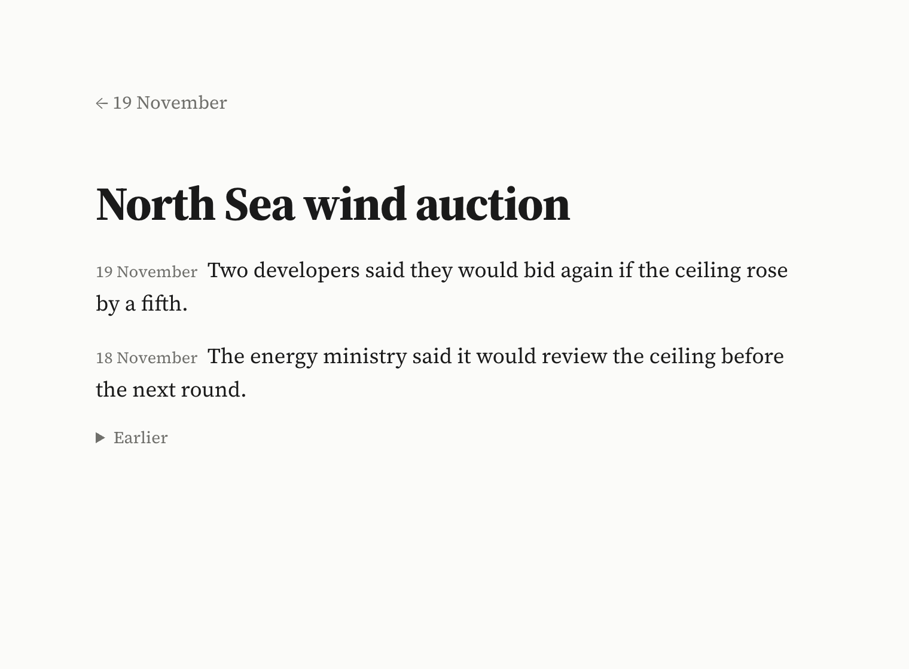
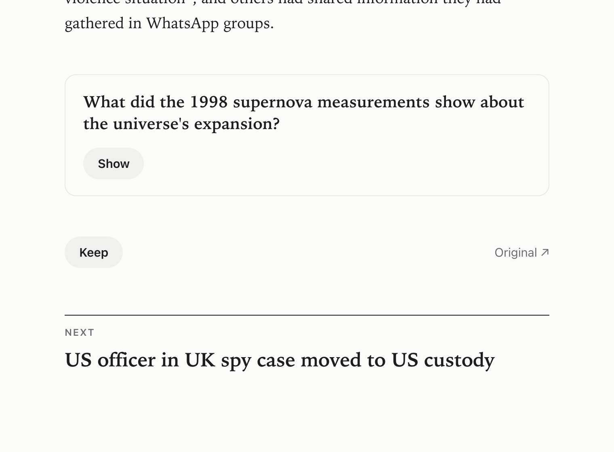
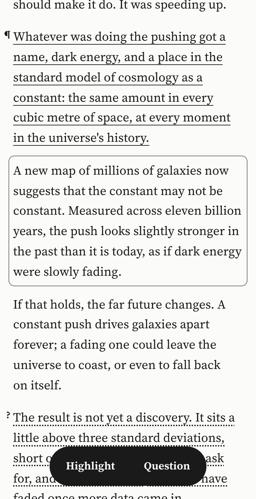
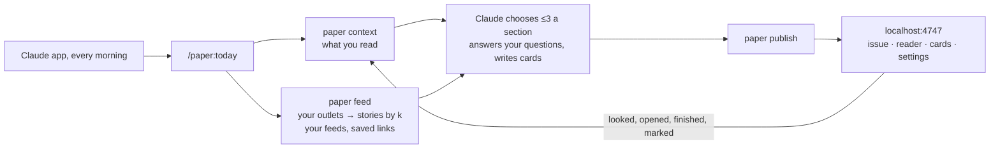

<h1 align="center">Morning paper</h1>

<p align="center">
Every story you follow, picked up where you left it.<br>
A morning paper your own Claude writes from the outlets you trust.
</p>

<p align="center">
  <picture>
    <source media="(prefers-color-scheme: dark)" srcset="docs/issue-dark.png">
    
  </picture>
</p>

## Why

A feed tells every story as if you had never seen it. You reread what you know, or you lose
the thread. Morning paper remembers what you read. Open a piece on a story once and the paper
follows it for you: each issue opens with **Since you left**, what changed in each of your
stories since you last read about it, a dated line a day, newest first, and nothing you already
know. A story that has not moved stays out, however big it is. Away for ten days, you get the
ten days.

<p align="center">
  <picture>
    <source media="(prefers-color-scheme: dark)" srcset="docs/story-dark.png">
    
  </picture>
</p>

That is possible because the record of what you read is yours. What you opened, finished,
marked and asked is kept in `~/paper` on your computer, encrypted, with the key in your keychain, and
read only by your own Claude when it writes the issue. No service keeps it, and nothing is sold against it.

The rest of the paper:

- **Independent sources decide what is news.** Every morning the news engine reads your
  outlets, groups their headlines into stories and counts the newsrooms behind each one (`k`).
  Two feeds of one newsroom count once, and a wire service counts only when it is alone.
- **One article a story, the best one.** For each story Claude picks the single best account
  you can read whole without paying, usually from the outlet that did the reporting. When a
  story rests on a law, a ruling or a statement, the document itself can be the piece.
- **It ends.** Up to three pieces a section, nothing to fill a slot, then a last page.
- **You keep what you read.** Tap a paragraph to highlight it or ask about it: the next issue
  answers your question, and cards from what you marked and finished come due, one after each
  piece you finish. A few pieces ask you to guess their finding before you read, and Sunday's
  issue ends with a crossword of your week.

<p align="center">
  <picture>
    <source media="(prefers-color-scheme: dark)" srcset="docs/reader-dark.png">
    
  </picture>
</p>

<p align="center">
  <picture>
    <source media="(prefers-color-scheme: dark)" srcset="docs/card-dark.png">
    
  </picture>
</p>

## Set up

You need the [Claude app](https://claude.com/download) on a paid plan, on a Mac, on Windows
with [Git for Windows](https://git-scm.com/downloads/win), or on Ubuntu or Debian (the app's Linux
beta). In the app's Code tab, type:

```
/plugin install paper --marketplace VeghV03/morning-paper
```

Then `/paper:setup`. Claude asks three things: where you live, the languages you read, and what
you want beyond the news. Then it asks which running stories you already follow, and your first
issue opens with their last week. It installs the paper's own tools in `~/paper` (nothing system-wide,
no password), starts the reader, writes a quick first issue while you watch, and schedules the
full one for every morning.

Open <http://localhost:4747> with your coffee, or read it on your phone: scan the code in
Settings with the phone's camera, install and trust the paper's certificate as the page shows,
then add the page to your home screen. The first time the icon opens, type the six digits shown
under the code.

<p align="center">
  <picture>
    <source media="(prefers-color-scheme: dark)" srcset="docs/phone-dark.png">
    
  </picture>
</p>

The morning run needs the Claude app open and the computer awake, or runs when you next open it.
Each issue uses your Claude plan: Claude searches the web and opens every article it considers.

### What setup changes on your computer

Setup says what each step does before it runs it, and asks first before touching your Claude
settings.

- Installs uv, Node and Python for the paper alone in `~/paper/.tools`, about 240 MB. Nothing
  system-wide, no password.
- Adds allow rules for the paper's tool, web search and the `~/paper` folder to
  `~/.claude/settings.json`, so the morning run never stops at a prompt.
- Starts the reader from login, and schedules the morning run in the Claude app.
- Keeps the reading record's key in the system keychain: Keychain on a Mac, Credential Manager
  on Windows, GNOME Keyring or KWallet on Linux.

To remove the paper, delete the paper's rules in that settings file, the morning task in the
Claude app, `~/paper`, the `morning-paper` keychain entry, and what starts the reader:
`~/Library/LaunchAgents/local.morning-paper.serve.plist` on a Mac, the "Morning paper" startup
app on Windows, `~/.config/systemd/user/morning-paper.service` on Linux.

## How it works



Your files and your reading record live in `~/paper` on your computer. Each morning Claude reads
them to choose the issue, as it reads anything in a conversation. The page answers your computer and
the phones you paired by scanning that code, and no one else. To the phone it travels over
HTTPS, with a certificate your computer made that can vouch only for its own `.local` name and
home-network addresses. What you read and mark is encrypted on disk; Settings shows its recovery
code once, and on a new computer `paper restore <code>` opens it again.

## Make it yours

What you want from the paper is plain files in `~/paper`. Ask Claude to change it, edit
it yourself, or open Settings at the foot of any issue.

<p align="center">
  <picture>
    <source media="(prefers-color-scheme: dark)" srcset="docs/settings-dark.png">
    
  </picture>
</p>

| File | What it is |
|---|---|
| `outlets.json` | The newsrooms the engine reads and counts. Two presets in `presets/`: World (English) and Hungary. |
| `sections.md` | One line per section, in page order: `Name: what belongs in it`, and topics after a `\|` for a section your reading steers. Eight at most. |
| `interests.md` | What you care about and what you are tired of, in your own words. |
| `feeds.yaml` | Blogs, journals and newsletters you follow; their best new posts go where they fit. |
| `inbox.md` | A link a line; it arrives in the next issue under Saved. |
| `paper.yaml` | The page's language, English or Hungarian. |

## Commands

| | |
|---|---|
| `/paper:setup` | Set up, or set up again. |
| `/paper:today` | Write today's issue now. |
| `~/paper/.tools/bin/paper check` | Which outlets and feeds answer. |

## Where it comes from

Morning paper is the newspaper of [x4r](https://github.com/VeghV03/x4r), a firmware for the
Xteink X4 e-reader, brought to the Mac.

MIT licensed.
