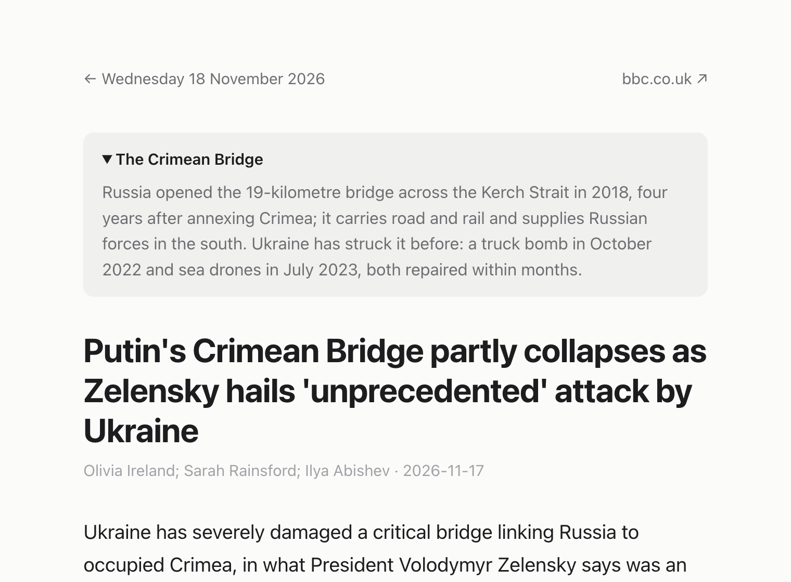
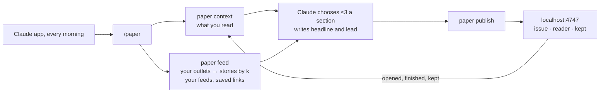
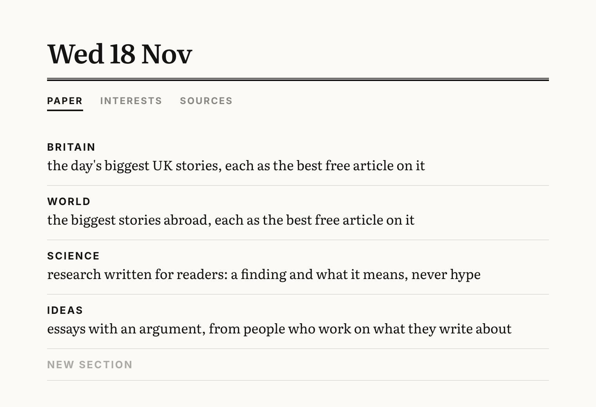

<h1 align="center">Morning paper</h1>

<p align="center">
One issue a day, chosen for you by your own Claude from the outlets you trust,<br>
ranked by how many independent newsrooms carry each story. Read it, close it, done.
</p>

<p align="center">
  <picture>
    <source media="(prefers-color-scheme: dark)" srcset="docs/issue-dark.png">
    
  </picture>
</p>

## Why

A feed never ends, so it never tells you when you are informed. A paper does: it has a last
page. Morning paper gives you one issue every morning, up to three pieces a section, and
nothing goes in to fill a slot. The next morning, a new issue takes the front page.

Three things make the choice better than a feed's:

- **Independent sources decide what is news.** Every morning the news engine reads your
  outlets, groups their headlines into stories and counts the newsrooms behind each one (`k`).
  Two feeds of one newsroom count once, and a wire service counts only when it is alone.
- **One article a story, the best one.** For each story Claude picks the single best account
  you can read whole without paying, usually from the outlet that did the reporting. When a
  story rests on a law, a ruling or a statement, the document itself can be the piece.
- **It learns what you actually read.** Pieces open in a clean reader on your Mac that notes
  what you opened, finished and kept. The next issue gives more room to what you finish and
  less to what you skip. Running stories get a short "story so far" above them.

<p align="center">
  <picture>
    <source media="(prefers-color-scheme: dark)" srcset="docs/reader-dark.png">
    
  </picture>
</p>

## Set up

You need a Mac, the [Claude app](https://claude.com/download) and [Homebrew](https://brew.sh).

```bash
git clone https://github.com/VeghV03/morning-paper.git ~/morning-paper
```

In the Claude app, open the Code tab, choose the `morning-paper` folder and say **set this
up**. Claude interviews you: where you live and which places you follow,
the languages you read, what you want beyond the news, the writers and journals you like.
It finds outlets and feeds for you and tests each one, writes your files, starts the reader,
writes your first issue while you watch, and schedules the next one for the morning.

After that, open <http://localhost:4747> with your coffee. The morning run needs the Claude
app open, or runs when you next open it, and each issue uses your Claude plan: Claude
searches the web and opens every article it considers.

## How it works



Your files and your reading record live in `~/paper` on your Mac. Each morning Claude reads
them to choose the issue, as it reads anything in a conversation. The reader page answers only
`localhost`.

## Make it yours

Everything the paper knows about you is a plain file in `~/paper`. Ask Claude to change it, edit
it yourself, or open the dashboard:

```bash
uv run paper dashboard
```

<p align="center">
  <picture>
    <source media="(prefers-color-scheme: dark)" srcset="docs/dashboard-dark.png">
    
  </picture>
</p>

| File | What it is |
|---|---|
| `outlets.json` | The newsrooms the engine reads and counts. Two presets in `presets/`: World (English) and Hungary. |
| `sections.md` | One line per section, in page order: `Name: what belongs in it`. Eight at most. |
| `interests.md` | What you care about and what you are tired of, in your own words. |
| `feeds.yaml` | Blogs, journals and newsletters you follow; their best new posts go where they fit. |
| `inbox.md` | A link a line; it arrives in the next issue under Saved. |
| `paper.yaml` | The page's language (English or Hungarian) and the morning run's time. |

## Commands

| | |
|---|---|
| `/setup` | The interview. |
| `/paper` | Write today's issue now. |
| `uv run paper check` | Which outlets and feeds answer. |
| `uv run paper dashboard` | Edit your files in the browser. |

## Where it comes from

Morning paper is the newspaper of [x4r](https://github.com/VeghV03/x4r), a firmware for the
Xteink X4 e-reader, brought to the Mac.

MIT licensed.
