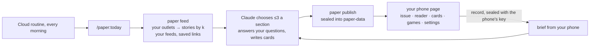
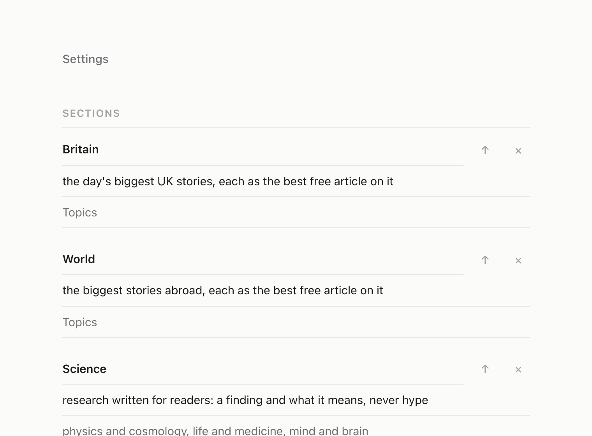

<h1 align="center">Morning paper</h1>

<p align="center">
Every story you follow, picked up where you left it.<br>
A morning paper your own Claude writes from the outlets you trust.
</p>

<p align="center">
  <picture>
    <source media="(prefers-color-scheme: dark)" srcset="docs/issue-dark.png">
    
  </picture>
</p>

## Why

A feed tells every story as if you had never seen it. You reread what you know, or you lose
the thread. Morning paper remembers what you read. Open a piece on a story once and the paper
follows it for you: each issue opens with **Since you left**, what changed in each of your
stories since you last read about it, a dated line a day, newest first, and nothing you already
know. A story that has not moved stays out, however big it is. Away for ten days, you get the
ten days.

<p align="center">
  <picture>
    <source media="(prefers-color-scheme: dark)" srcset="docs/story-dark.png">
    
  </picture>
</p>

That is possible because the record of what you read is yours. What you opened, finished,
marked and asked is sealed on your phone with a key only your devices hold, and kept in a private
GitHub repository of yours. The cloud run that writes the issue never gets that key: your phone
sends it a short brief of what to weigh, and nothing else. No service keeps your reading, and
nothing is sold against it.

The rest of the paper:

- **Independent sources decide what is news.** Every morning the news engine reads your
  outlets, groups their headlines into stories and counts the newsrooms behind each one (`k`).
  Two feeds of one newsroom count once, and a wire service counts only when it is alone.
- **One article a story, the best one.** For each story Claude picks the single best account
  you can read whole without paying, usually from the outlet that did the reporting. When a
  story rests on a law, a ruling or a statement, the document itself can be the piece.
- **It ends.** Up to three pieces a section, nothing to fill a slot, then a last page.
- **You keep what you read.** Tap a paragraph, or select a few words, to highlight them or ask
  about them: the next issue answers your question, and cards from what you marked and finished
  come due, one after each piece you finish. A few pieces ask you to guess their finding before
  you read, an English issue has Lede, a five-letter word from one of its pieces to guess in six
  tries, and Sunday's issue has a crossword of your week.
- **It learns mostly from what you finish.** In the sections you steer, each topic
  has an estimate built from what you finish, keep, mark and later remember, and every section
  keeps one slot for the topic it has seen least. Each of those pieces says why it is there, with
  Less of this beside it. Cards come back on a schedule fitted to your own reviews, once that
  fit predicts them better than the default.

<p align="center">
  <picture>
    <source media="(prefers-color-scheme: dark)" srcset="docs/reader-dark.png">
    
  </picture>
</p>

<p align="center">
  <picture>
    <source media="(prefers-color-scheme: dark)" srcset="docs/card-dark.png">
    
  </picture>
</p>

## Set up

You need the [Claude app](https://claude.com/download) on a plan with cloud routines, a GitHub
account, and once, for setup, a Mac, Windows with [Git for Windows](https://git-scm.com/downloads/win),
or Ubuntu or Debian. In the app's Code tab, type:

```
/plugin install paper --marketplace VeghV03/morning-paper
```

Then `/paper:setup`. Claude asks three things: where you live, the languages you read, and what
you want beyond the news. It writes your files, makes a recovery code you save in your password
manager, and puts your files, sealed, in a private repository of yours. Three steps are yours,
because they hold your credentials: a cloud environment holding the run's key, which
repositories Claude's GitHub app may reach, and a token for your phone. Claude then schedules the
morning run, runs it once, and puts the phone page in a repository of your own on GitHub Pages.
About six minutes later your first issue opens on your phone. Add it to your home screen.

<p align="center">
  <picture>
    <source media="(prefers-color-scheme: dark)" srcset="docs/phone-dark.png">
    
  </picture>
</p>

Each issue uses your Claude plan: Claude searches the web and opens every article it considers.

### What setup leaves behind

Setup says what each step does before it runs it, and asks before it makes anything on GitHub.

- On your computer: uv, Node and Python for the paper alone in `~/paper/.tools`, about 240 MB,
  nothing system-wide and no password; your files in `~/paper`; the recovery code in the system
  keychain (Keychain on a Mac, Credential Manager on Windows, GNOME Keyring or KWallet on Linux).
- On GitHub: `paper-data`, private, holding only sealed files, and `paper-reader`, public,
  holding the phone page's code and nothing of yours. The page is served from `<you>.github.io`, an
  address every GitHub Pages site of your account shares, so keep it the only one there: a script
  on another could read what the phone keeps.
- In the Claude app: the `morning-paper` cloud environment and the Morning paper routine.

To remove the paper, delete those: the routine and the environment in the Claude app, the two
repositories, the phone's token in GitHub's settings, `~/paper`, and the `morning-paper`
keychain entry.

## How it works



Your files, issues and reading record live in `paper-data`, each file sealed with AES-256-GCM.
The recovery code gives two keys. The run key opens your files and issues, and sits in the cloud
environment. The record key opens what you read, and never leaves your devices. The phone page
is served from your own `paper-reader` and never from this repository, so a change here reaches
your phone only when you copy it over.

## Make it yours

What you want from the paper is a handful of plain files, sealed in `paper-data`. Change them in
Settings on your phone: your sections and their topics, interests, feeds, newsrooms and the
page's language.

<p align="center">
  <picture>
    <source media="(prefers-color-scheme: dark)" srcset="docs/settings-dark.png">
    
  </picture>
</p>

| File | What it is |
|---|---|
| `outlets.json` | The newsrooms the engine reads and counts. Two presets in `presets/`: World (English) and Hungary. |
| `sections.md` | One line per section, in page order: `Name: what belongs in it`, and topics after a `\|` for a section your reading steers. Eight at most. |
| `interests.md` | What you care about and what you are tired of, in your own words. |
| `feeds.yaml` | Blogs, journals and newsletters you follow; their best new posts go where they fit. |
| `inbox.md` | A link a line; it arrives in the next issue under Saved. Save a link on the phone adds to it. |
| `paper.yaml` | The page's language, English or Hungarian. |

## Commands

| | |
|---|---|
| `/paper:setup` | Set up, or set up again. |
| `~/paper/.tools/bin/paper check` | Which outlets and feeds answer. |
| `~/paper/.tools/bin/paper cloud code` | Show your recovery code, in your own terminal. |

## Where it comes from

Morning paper is the newspaper of [x4r](https://github.com/VeghV03/x4r), a firmware for the
Xteink X4 e-reader, brought to the phone.

MIT licensed.
